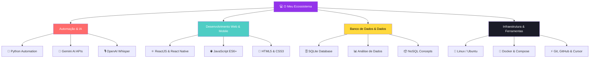

- 👋 Olá! Sou Lucas, estudante de ```Análise e Desenvolvimento de Sistemas.```
- 💻 Desenvolvedor em formação, com foco em **desenvolvimento de software e aplicações web**.
- 🚀 Tenho experiência prática com projetos utilizando ```Python``` ```HTML``` ``` CSS``` e ```JavaScript.```
- 🌱 Em constante aprendizado, buscando aprimorar lógica de programação, boas práticas e novas tecnologias.

**Python · JavaScript · React · SQL** | ReactJS · React Native · Linux · Git | Gemini API · Docker · SQLite


<a href="https://github.com/luccas">
  


## 🚀 Minhas Skills


##
- 🤖 Ferramentas & IA's
<div>
  
  
  
  
  
##

- 📫 Você pode me encontrar
<div>
  <a href="mailto:lukasfernandessilva05@gmail.com" target="_black"></a>
  <a href="https://www.linkedin.com/in/fernandes-luccas/" target="_black"></a>
</div>
<div>

### 💡 O que estou construindo


  


